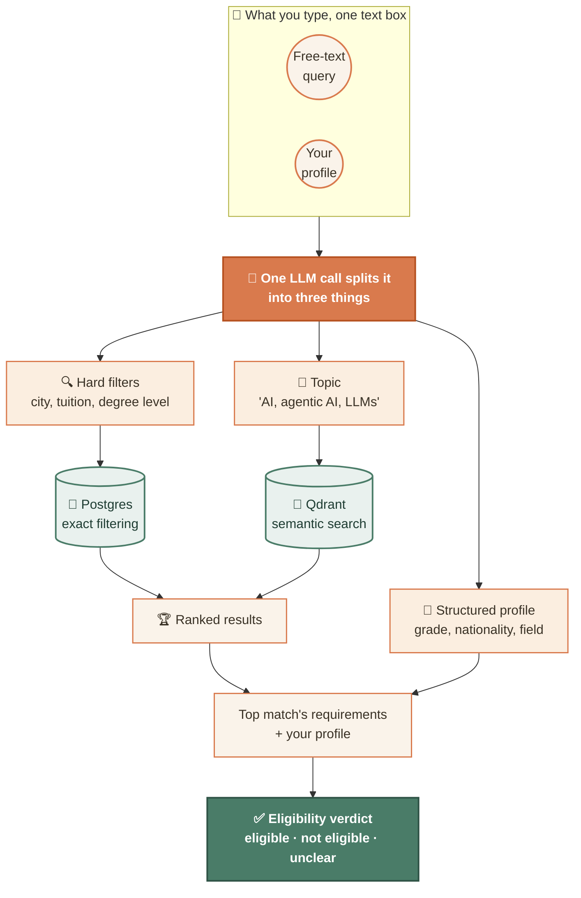
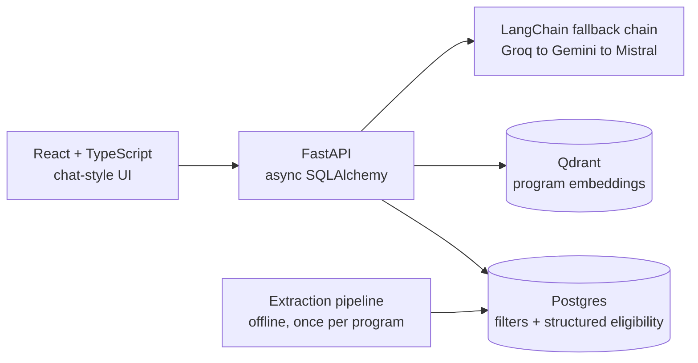

# Study in Germany: Hybrid Retrieval & Eligibility Engine for German Study Programs

🐌 *Your international student counselor for German universities. Write your query and the snail find the right program for you..*

[](https://github.com/MuneebaNasir/StudyMatch/actions/workflows/ci.yml)

**[Try it live →](https://frontend-snowy-ten-66.vercel.app)**

<p align="center">
  
</p>

🐌 [Watch with sound (mp4)](assets/demo.mp4)

## Does it actually work?

Yes, it's live. You type your query the way you'd actually say it out loud, not the way a filter UI expects:

> *"I'm looking for a Master's in robotics, taught in English, no tuition fees, near Berlin. I have a 3.2 GPA on a 4.0 scale from Pakistan, and an IELTS score of 7.0."*

It searches all ~2,400 real German international study programs listed on DAAD and comes back with a ranked list, each one carrying an actual eligibility verdict. Not a maybe.

📜 **Got a transcript?** Upload it (PDF or a photo/scan) and a vision LLM reads every course and grade off the page, so the eligibility check can judge your actual coursework against each program's prerequisites, not just your degree title. Nothing is saved on the server.

It runs entirely on free-tier infrastructure (Vercel + Google Cloud Run + Neon Postgres + Qdrant Cloud).

## The problem

Most program search tools make you speak their language: pick from dropdowns, guess the right keyword, hope "no tuition fees" is phrased the way the site expects. A student should be able to just describe what they're looking for, in their own words, the way they'd explain it to a study abroad counselor, and it will also check your eligibility.

## Tech stack

- **AI/LLM:** LangChain (structured output + `.with_fallbacks()`), Groq (GPT-OSS 120B), Google Gemini, Mistral, `sentence-transformers` (local embeddings, `BAAI/bge-large-en-v1.5`, no API key/rate limit)
- **Transcript reading:** vision LLMs (Gemini → Ministral → Qwen fallback chain, with a check that rejects empty or ungraded extractions), PyMuPDF for PDF rasterization
- **Backend:** Python, FastAPI, SQLAlchemy (async), Pydantic
- **Data:** PostgreSQL (Neon), Qdrant (vector search)
- **Frontend:** React, TypeScript, Vite, TanStack Query, Radix UI, Tailwind CSS
- **Deployment:** Google Cloud Run (backend, scale-to-zero), Vercel (frontend), Docker, all on free tiers
- **Evaluation:** MLflow (experiment tracking, LangChain tracing, `mlflow.genai.evaluate` with custom scorers and a Groq LLM judge)
- **Testing:** pytest + Vitest/Testing Library/MSW, TDD throughout, 200+ tests across both stacks
- 
## How it works (and why it doesn't Hallucinate)

Every query gets split into three things by a single LLM call: hard filters, a topic string, and your structured profile. Two databases hold two different kinds of truth about each program, and a search touches both:

- 🔍 **Filters** (tuition, city, degree level) hit **Postgres**, which also holds each program's admission requirements, pre-extracted into structured fields like a grade threshold or which language tests are accepted.
- 🧠 **The topic** gets embedded and matched against **Qdrant** semantically, so "agentic AI and large language models" can match a program that never uses those exact words, by comparing meaning rather than keywords.
- ✅ **Your eligibility verdict** only ever compares your structured profile against a program's structured requirements, never the raw admissions paragraph. If there's no clean field to point to, it says "unclear" instead of guessing.

On the LLM side, a three-tier fallback chain (Groq's GPT-OSS 120B → Gemini → Mistral, via LangChain) keeps things running if a provider goes down 🐌. A local embedding model (`BAAI/bge-large`, via `sentence-transformers`) keeps semantic search alive even if all three cloud LLMs are unavailable.



1. **Query to structure.** One LLM call turns your text into hard filters, a topic string, and a profile.
2. **Matching.** The filters narrow the candidates in Postgres; the topic string gets embedded and ranked by similarity against Qdrant. Both apply together.
3. **Results.** You get a ranked list, each program tagged with an eligibility status.
4. **Profile matching.** For the top match, your structured profile and the program's structured requirements, never raw text, go to the LLM together, which returns a verdict and a short reason. Every other result is checkable the same way on demand, so the app isn't paying for an LLM call on results you never open.

## Architecture



## Under the hood

- **Structured extraction, not raw-text matching.** Admission requirements are extracted into a typed schema once, ahead of time, so eligibility reasoning is a structured-data comparison, not an LLM re-reading legal text on every query.
- **Hallucination mitigation as several mechanisms, not one fix.** Structured output constrains what the model can return. An explicit `"unclear"` verdict lets it admit uncertainty instead of guessing. Extraction confidence (high/medium/low) is tracked per program. Anything computable, like grade conversion, is computed in code, never asked of the model.
- **Three-provider fallback chain.** Groq → Gemini → Mistral via LangChain's `.with_fallbacks()`, so one provider's outage doesn't take the pipeline down. A custom callback handler confirms which provider actually answered each call, for observability.
- **Deterministic math kept out of the LLM's hands.** Grade-scale conversion (e.g. a US 4.0 GPA to the German 1.0–5.0 scale) is a fixed formula in code, not a model guess, after observing a weaker fallback-tier model get a grade comparison backwards.
- **Cost-aware by measurement.** Real token costs were measured on live traffic (~1,119 tokens to parse a query, ~4,932 for a batch eligibility call) and used to cap automatic reasoning to the top result only, cutting default per-query cost by ~90%.
- **Graceful degradation everywhere.** A failed LLM call falls back to semantic search over raw text. A failed embedding call falls back to filtered search. Same philosophy at every LLM/vector boundary.
- **Structured production logging.** Every query logs which provider responded, the extracted search filters, and each eligibility verdict, so real behavior is inspectable after the fact.
- **No personal data at rest.** Uploaded transcripts are processed in memory and never written to disk or the database; the extracted courses and grades go back to the browser, which holds them in memory and resends them with each query. Logs deliberately omit the raw query text and the student profile.

## Evaluation with MLflow

Free-tier providers retire models, change behaviour and run out of quota without warning, so "it worked yesterday" isn't evidence. `evals/` measures the app's three LLM steps against small labelled datasets and logs every run to MLflow:

- **Query understanding**: 10 queries, scored field by field (degree type, city, language, tuition, the student's own grade and nationality).
- **Eligibility verdicts**: 10 synthetic student profiles against real programmes' requirements, including traps (10-point CGPA, German grades where lower is better, unrelated degrees). A Groq LLM judge checks the reasoning for factual errors.
- **Transcript reading**: generated transcripts with known courses and grades, scored on course recall and grade accuracy.

Every run records which provider actually answered, latency, tokens and provider errors, and traces each LangChain call. `--per-provider` forces Groq, Mistral and Gemini in turn on the same cases. A built-in guard caps Gemini at 5 calls per run, since the eval uses the same free-tier keys as the live site.

```bash
uv sync --extra eval
uv run python -m evals.run all                 # or: query | eligibility | transcript
uv run python -m evals.run all --per-provider  # compare providers
mlflow ui --backend-store-uri sqlite:///mlflow.db
```

What the first runs found:

- **Groq's primary model failed 9 of 10 eligibility calls** with `tool_use_failed`: it answered in prose instead of the structured tool call, so production silently fell back to weaker tiers. Groq's JSON-schema output mode got 3/3 right in a follow-up check.
- **The fallback model's reasoning had factual errors in every judged case** (e.g. treating a German 2.8 as meeting a 2.5 limit), against none for Groq.
- **City spellings:** the parser returns "Munich"/"Cologne" while the catalog stores "München"/"Köln", so those city filters match nothing (8/10 queries fully correct, both misses are this).
- **Speed:** query parsing took 1.7s on Groq, 2.8s on Mistral and 9.0s on Gemini.
- It also caught its own labelling mistakes: two programmes required a German A1 certificate or the GRE that the first test profiles left out.

## File structure

```
├── src/daad_search/
│   ├── api/                  # FastAPI routes, query orchestration, request/response schemas
│   ├── query_understanding/  # LLM query parsing, eligibility reasoning, LangChain fallback chain
│   ├── extraction/           # Offline pipeline: raw admission text -> structured eligibility
│   ├── ingestion/            # Embedding generation, Qdrant upsert
│   ├── scraping/             # DAAD catalog scraper
│   └── db/                   # SQLAlchemy models, session management
├── frontend/src/
│   ├── components/           # Query box, results list, admission-guide drawer, loading states
│   ├── hooks/                # TanStack Query hooks (search, pagination, eligibility evaluation)
│   ├── api/                  # Typed API client
│   └── lib/                  # Verdict merging, display helpers
├── evals/                    # MLflow evaluation: labelled datasets, scorers, provider spy, runner
├── tests/                    # pytest suite (unit + integration, real Postgres/Qdrant for integration)
├── Dockerfile                # Backend container (CPU-only torch, multi-stage build)
└── docker-compose.yml        # Local Postgres + Qdrant for development
```

## Running locally

```bash
# Backend
docker compose up -d          # Postgres + Qdrant
cp .env.example .env          # fill in your own API keys
uv sync --extra dev
uv run uvicorn daad_search.api.main:app --reload

# Frontend
cd frontend
npm install
npm run dev
```

Run tests: `uv run pytest -m "not integration"` (backend) and `npm test` (frontend, from `frontend/`).

## Author

**Muneeba Nasir**
[LinkedIn](https://linkedin.com/in/muneeba-nasir-5412bb166/) · muneebanasir2@gmail.com

## License

All rights reserved. The code is public so it can be read and evaluated, but it may not be copied, modified, or reused without written permission. See [LICENSE](LICENSE).
